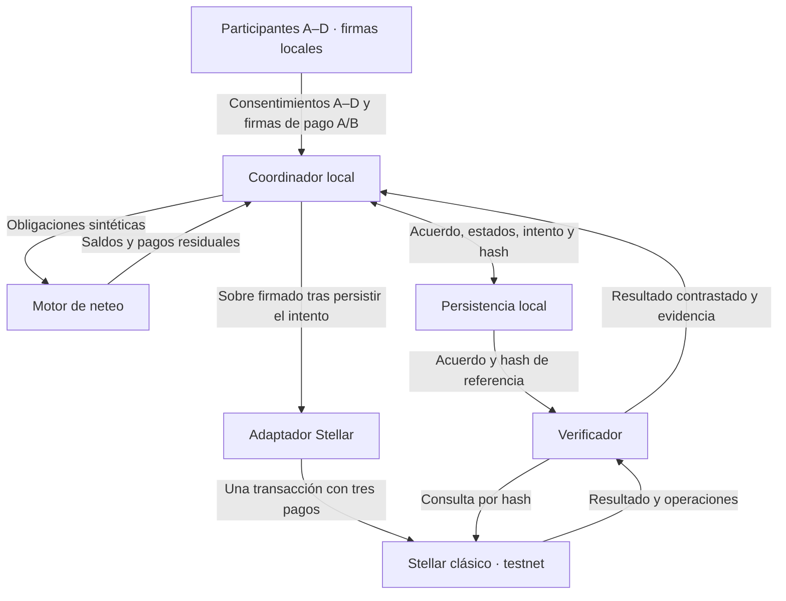

# CuyNexo · Diagrama de arquitectura

**Diseño del P0 basado en la v0.3, con base técnica aprobada.** El motor de neteo está disponible en esta rama. La integración y las pruebas de testnet siguen pendientes. [Ver documento de arquitectura](./arquitectura.md).

- **Aplicación:** comprueba el consentimiento de los cuatro participantes para la misma versión del acuerdo.
- **Stellar clásico:** comprueba las firmas de las cuentas fuente y aplica las operaciones juntas. El prototipo debe demostrarlo en testnet.
- **Resultado incierto:** el verificador consulta el mismo hash. La interfaz muestra que el resultado sigue en revisión.
